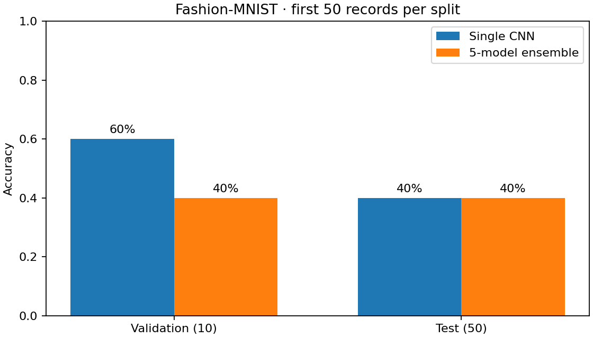
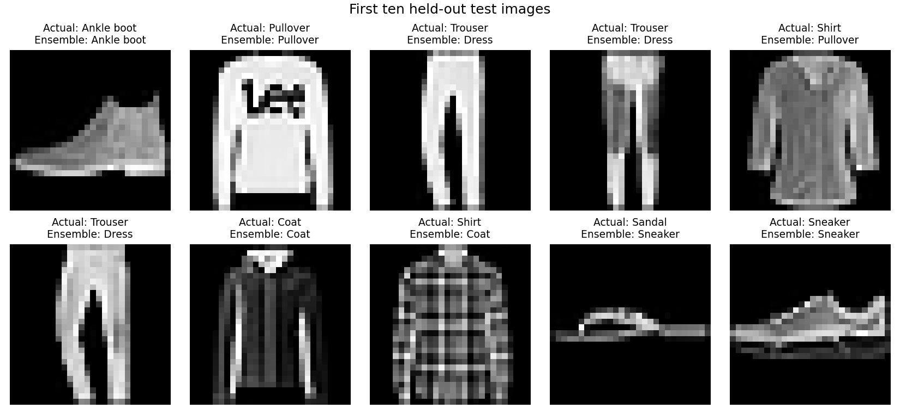

# Fashion-MNIST Bootstrap CNN Ensemble

μLearn **Ensemble CNN for Fashion-MNIST Classification** · `#cl-ai-ensemblecnn`

This experiment follows the task's prescribed first-50-record subset. It compares one convolutional network with a five-model bootstrap ensemble. Built with Codex assistance.

## Data and method

1. Load the official Fashion-MNIST train and test arrays with `keras.datasets.fashion_mnist.load_data()`.
2. Select the first 50 images from each array, normalize to [0, 1], and reshape to (28, 28, 1).
3. Use `train_test_split` with seed 42 and 20% validation to divide the 50 training images into 40 training and 10 validation images. Keep the official test array separate.
4. For each of five ensemble members, sample 40 training indices with replacement. Fit three epochs with its own seed.
5. Average the five probability vectors before taking the predicted class.
6. Train a single model on all 40 training images for three epochs, using the same architecture, Adam optimizer, loss, and batch size. Report both models' validation and test accuracies.

Each CNN has Input → Conv2D(32, 3×3, ReLU) → MaxPooling2D(2×2) → Flatten → Dense(10, softmax). It uses Adam and sparse categorical crossentropy, with batches of eight. No validation or test examples enter training. Validation is only used for reporting, with no tuning or early stopping.

## Run

Use Python 3.12 and a CPU.

```bash
python3 -m venv .venv
source .venv/bin/activate
pip install -r requirements.txt
python experiment.py
```

The first run downloads Fashion-MNIST from Keras. The script writes metrics, exact split/bootstrap indices, probability arrays, test predictions, and figures into `results/`. The GitHub Actions workflow runs the same script and retains the outputs as a downloadable artifact.

## Verification

The script checks split separation, bootstrap membership, input dimensions and range, and finite normalized probability outputs. Seeds and package versions are recorded so the run can be inspected and reproduced.

## Limits

The task deliberately uses only 50 source training images and 50 test images. Validation has just ten examples, so one prediction changes its accuracy by ten percentage points. These results are a small demonstration and cannot establish a general advantage for either method. No hyperparameters or seeds are selected using the test results.

## References

- [Keras Fashion-MNIST dataset](https://keras.io/api/datasets/fashion_mnist/)
- [Keras training API](https://keras.io/api/models/model_training_apis/)
- [Keras reproducibility guide](https://keras.io/examples/keras_recipes/reproducibility_recipes/)

## Recorded results

The [verified GitHub Actions run](https://github.com/UmarAlMukhtar/mulearn-fashion-ensemble/actions/runs/45029879797) completed on the CPU with TensorFlow 2.20.0, Keras 3.15.1, and NumPy 2.2.6.

| Method | Validation accuracy (10 images) | Test accuracy (50 images) |
| --- | --- | --- |
| Single CNN | 60% (6/10) | 40% (20/50) |
| Five-model ensemble | 40% (4/10) | 40% (20/50) |

The ensemble tied the single CNN on this test subset and performed worse on validation. Bootstrap resampling reduces the number of unique examples seen by each member, and three epochs on forty images leave substantial room for underfitting. This run does not demonstrate an ensemble benefit. The subset size and three-epoch limit follow the challenge brief.





[Metrics and member scores](results/metrics.json) · [Exact split and bootstrap indices](results/split-and-bootstrap.json) · [Test predictions](results/test-predictions.csv) · [Probability arrays](results/probabilities.npz)
